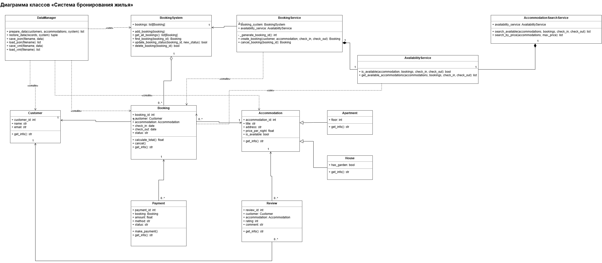
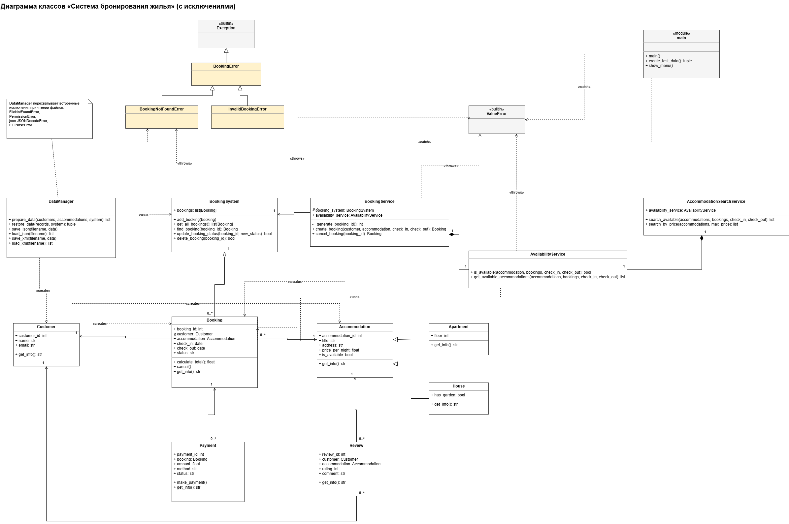

# housing-booking-system
Система бронирования жилья на Python

Возможности программы:

Просмотр и поиск бронирований;
Создание бронирований;
Изменение статуса бронирования;
Удаление бронирований;
Добавление клиентов и жилья;
Поддержка квартир и частных домов;
Расчёт стоимости проживания;
Сохранение и загрузка данных в форматах JSON и XML;
Обработка ошибок и исключений.

Структура программы:
models/ — классы клиентов, жилья, бронирований и другие модели
services/ — управление бронированиями и работа с данными
data/ — файлы данных JSON и XML
exceptions.py — пользовательские исключения
main.py — запуск программы и главное меню

Запуск программы:
Необходимо скачать или клонировать репозиторий, открыть папку проекта в PyCharm
и запустить файл в main.py.
После запуска появится меню, в котором можно выбрать необходимое действие.

Работа с данными: программа позволяет сохранять и загружать информацию о клиентах,
жилье и бронированиях в форматах JSON и XML. Файлы хранятся в папке data/.

Обработка ошибок: в проекте есть встроенные исключения Python и пользовательские
исключения для обработки ошибок, связанных с бронированиями и данными.

Диаграммы классов UML: 
Диаграммы классов показывают структуру системы бронирования жилья Housing Booking System, 
включая основные классы, их атрибуты, методы и связи между ними.

